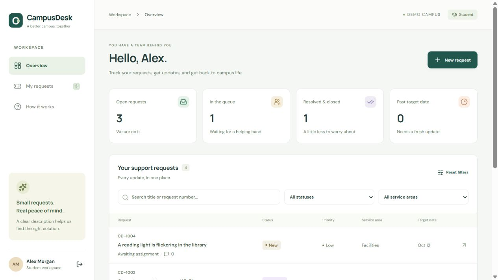
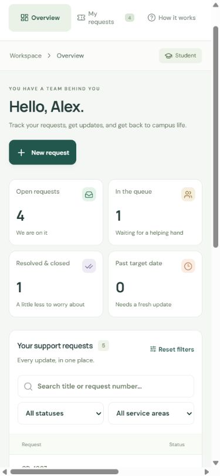

# CampusDesk


Ứng dụng tiếp nhận và xử lý yêu cầu hỗ trợ trong trường học.
Sinh viên gửi yêu cầu và theo dõi phản hồi; nhân viên dùng chung hàng đợi để phân công,
đổi trạng thái và ghi chú nội bộ.

Dự án dùng React, TypeScript, Express và SQLite. Dữ liệu mẫu là hư cấu.

## Thư viện hướng dẫn

- Sinh viên tìm bài đã xuất bản theo nội dung và nhóm dịch vụ, đọc hướng dẫn trước khi gửi yêu cầu.
- Biểu mẫu **New request** gợi ý tối đa ba bài cùng nhóm dịch vụ, ưu tiên bài có từ khóa phù hợp.
- Nhân viên tạo bản nháp, sửa nội dung, xuất bản, đưa lại về nháp hoặc lưu trữ bài.
- Bản nháp, bài lưu trữ và lịch sử biên tập chỉ dành cho nhân viên; API kiểm tra quyền ở mỗi yêu cầu.
- Tìm kiếm hỗ trợ tiếng Việt có dấu/không dấu. Nội dung bài là văn bản thuần với các dòng xuống hàng.
- Khi hai người cùng sửa, bản cũ bị từ chối; biểu mẫu giữ phần đang nhập và cho so sánh với bản mới.
- Lưu bản nháp lần đầu có mã yêu cầu riêng, cho phép thử lại sau khi mất phản hồi mà không tạo bài trùng.

Trong **Knowledge library**, chọn bài để đọc. Nhân viên chọn **New guide → Save draft → Publish guide**
để xuất bản. **Archive guide** ẩn bài khỏi sinh viên; bài vẫn còn để phục hồi về bản nháp.
Xem [luồng xử lý và API của thư viện](docs/knowledge.md).

## Chạy bằng Docker

```bash
docker compose up --build -d
```

Mở http://127.0.0.1:3001. Compose dành cho bản thử trên máy cá nhân: chỉ mở cổng ra loopback,
bật dữ liệu hư cấu và giữ database trong volume `campusdesk-data`.
`docker compose down` giữ volume. Docker image chạy bằng tài khoản `node`, có healthcheck SQLite.

Khi triển khai thật, dùng HTTPS và cấu hình theo [hướng dẫn triển khai, sao lưu và nâng dữ liệu](docs/deployment.md).

## Chạy ở máy cá nhân

Cần Node.js 24 trở lên và npm.

```bash
npm ci
cp .env.example .env
npm run dev
```

Với PowerShell, dùng `Copy-Item .env.example .env` để sao chép cấu hình.
Mở http://127.0.0.1:5173. Backend chạy ở cổng 3001.

`APP_ORIGIN` phải trùng địa chỉ mở trên trình duyệt, gồm cả hostname và cổng.
Database mẫu chỉ được tạo khi database đang trống, không đặt lại sau mỗi lần khởi động.

| Vai trò   | Email mẫu                   | Mật khẩu mẫu    |
| --------- | --------------------------- | --------------- |
| Sinh viên | student@campus.example.test | CampusDemo!2026 |
| Nhân viên | staff@campus.example.test   | CampusDemo!2026 |

Các tài khoản này dùng để thử trên môi trường riêng.
Đăng ký thông thường chỉ tạo tài khoản sinh viên.

## Luồng xử lý

1. Sinh viên gửi yêu cầu với nhóm dịch vụ, mức ưu tiên và nội dung.
2. Nhân viên nhận việc, phân công và chuyển trạng thái:
   New → Triaged → In progress → Resolved → Closed.
3. Phản hồi công khai được gửi về cho sinh viên; ghi chú nội bộ chỉ nhân viên đọc được.
4. Nhân viên có thể mở lại yêu cầu đã đóng. Yêu cầu đang đóng không nhận thêm bình luận.

Danh sách có tìm kiếm, bộ lọc và phân trang. Thay đổi từ một bản dữ liệu cũ sẽ bị từ chối
bằng mã `409` để tránh ghi đè cập nhật của người khác.

## Kiểm tra và build

```bash
npm run check
npm run format:check
npm start
```

Để chạy bản build cục bộ, đặt `APP_ORIGIN=http://127.0.0.1:3001` trong `.env`.

Khi đưa lên host, dùng HTTPS, đặt `NODE_ENV=production`, `DEMO_SEED=0`,
`COOKIE_SECURE=1` và trỏ `DATABASE_PATH` đến ổ lưu trữ cố định.
Nếu host yêu cầu lắng nghe từ bên ngoài, đặt `HOST=0.0.0.0`.
Bản này dùng một tiến trình ứng dụng.

Sau khi build, tạo nhân viên đầu tiên bằng:

```bash
npm run create-staff
```

Lệnh hỏi tên, email và mật khẩu; không chuyển tài khoản sinh viên đã có thành nhân viên.

## Cấu trúc và dữ liệu

- `src/`: màn hình đăng nhập, danh sách yêu cầu và hộp thoại xử lý.
- `shared/types.ts`: loại yêu cầu, trạng thái và kiểu API.
- `server/app.ts`: route, kiểm tra quyền, CSRF và transaction.
- `server/database.ts`: lược đồ, chỉ mục và dữ liệu mẫu.
- `tests/`: kiểm thử quyền truy cập, ghi chú nội bộ, chuyển trạng thái và cập nhật đồng thời.

Quyền sinh viên và nhân viên được kiểm tra ở API.
Mật khẩu dùng scrypt; phiên đăng nhập dùng cookie HttpOnly.
API không trả nội dung hoặc số lượng ghi chú nội bộ cho sinh viên.

## Kiểm thử trình duyệt

```bash
npm run build
npx playwright install chromium
npm run test:browser
```

Kiểm thử mở giao diện thật và dùng SQLite riêng: nhân viên xuất bản/sinh viên đọc,
hai người cùng sửa, mất phản hồi khi lưu, gợi ý đến muộn, biểu mẫu đang gửi,
màn hình điện thoại, bài bị lưu trữ và phiên đăng nhập hết hạn.

[GitHub Actions](https://github.com/nguyenhonggiang2407/CampusDesk/actions/workflows/ci.yml)
chạy kiểm thử API/dữ liệu, TypeScript, build, trình duyệt, Docker và giữ dữ liệu sau khi khởi động lại.
Ảnh được lưu trong artifact `campusdesk-screenshots` của từng lần chạy.

Database v1 được nâng lên v2 trong transaction, giữ tài khoản, phiên đăng nhập, yêu cầu và bình luận.
Bản có sẵn dữ liệu không tự chèn thêm hướng dẫn mẫu.

Ứng dụng chưa có gửi email, tệp đính kèm, SSO hoặc giao diện quản lý nhân viên.

## Hình ảnh





## Giấy phép

Mã ứng dụng và logo dùng [MIT License](LICENSE). Các thư viện giữ giấy phép riêng.
