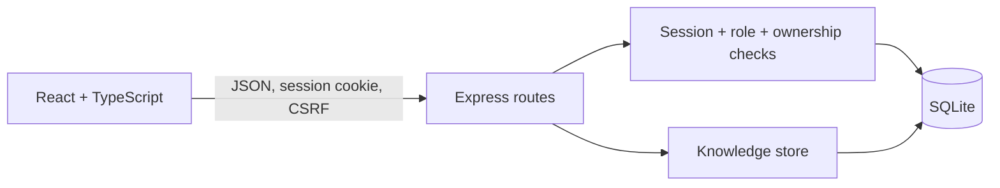

# Kiến trúc CampusDesk

Tài liệu này mô tả mã hiện có, không phải kiến trúc dự kiến.

Trong bản production, `server/app.ts` phục vụ cả API và `dist/client` sau build.
Trong development, Vite chuyển `/api` đến Express. Không có một service hoặc
repository layer riêng cho ticket: route gọi câu lệnh SQLite có tham số trực tiếp.
Knowledge library tách route và logic lưu trữ trong `knowledge-routes.ts` và
`knowledge-store.ts`.

## Luồng yêu cầu và quyền truy cập

1. Sinh viên đăng nhập; server kiểm tra scrypt và tạo cookie `campus_session`.
   Database lưu bản băm token và CSRF token, không lưu token phiên dạng gốc.
2. Sinh viên tạo ticket; API lấy chủ sở hữu từ phiên, không nhận vai trò hay
   `student_id` từ client. Sinh viên chỉ đọc ticket của mình.
3. Nhân viên xem hàng đợi, gán nhân viên, đổi ưu tiên/hạn/trạng thái và viết ghi chú.
   API kiểm tra vai trò ở mỗi thao tác; sinh viên không thấy ghi chú nội bộ hoặc số đếm của chúng.
4. Client gửi `version` khi sửa ticket. Server kiểm tra chuyển trạng thái hợp lệ,
   dùng `UPDATE ... WHERE id=? AND version=?`, tăng version và thêm sự kiện trong
   `BEGIN IMMEDIATE`/`COMMIT`. Cập nhật cũ bị từ chối với `409`.
5. Ticket đã đóng từ chối bình luận mới cho đến khi nhân viên mở lại.

Cookie có HttpOnly và SameSite=Lax; production bắt buộc Secure và origin HTTPS.
Thao tác ghi yêu cầu JSON, kiểm tra Origin khi trình duyệt gửi header và kiểm tra
CSRF với thao tác đã đăng nhập. Đăng ký thông thường luôn tạo sinh viên;
nhân viên đầu tiên được cấp bằng công cụ máy chủ `npm run create-staff`.

## Dữ liệu

| Bảng                    | Vai trò và quan hệ                                                                   |
| ----------------------- | ------------------------------------------------------------------------------------ |
| `users`                 | Email duy nhất, mật khẩu băm, vai trò `student` hoặc `staff`.                        |
| `sessions`              | Bản băm token, người dùng, CSRF token, thời điểm hết hạn.                            |
| `tickets`               | UUID, số tham chiếu duy nhất, sinh viên, người được gán, trạng thái, hạn và version. |
| `comments`              | Ticket, tác giả, nội dung và phạm vi `public`/`private`.                             |
| `ticket_events`         | Ticket, người thực hiện và thay đổi trong lịch sử.                                   |
| `knowledge_guides`      | Hướng dẫn, nhóm dịch vụ, trạng thái, nội dung tìm kiếm và version.                   |
| `knowledge_events`      | Lịch sử biên tập/xuất bản gắn với hướng dẫn và nhân viên.                            |
| `knowledge_create_keys` | Khóa yêu cầu tạo bài, tránh tạo trùng khi thử lại.                                   |
| `login_limits`          | Giới hạn đăng nhập/đăng ký và một số thao tác ghi.                                   |

SQLite bật foreign keys, WAL và busy timeout 5 giây. Schema version 2 được cài
trong transaction. Database v1 được nâng lên mà không thay tài khoản, ticket,
phiên hoặc bình luận; schema mới hơn bị từ chối. Seed chỉ chạy khi bảng tài khoản
trống. Xem [sao lưu và nâng dữ liệu](deployment.md).

## Phạm vi kiểm thử và giới hạn

`npm test` kiểm tra API với SQLite riêng: quyền, CSRF, dữ liệu nội bộ, chuyển trạng
thái, version xung đột, rollback, migration, idempotency và trạng thái chờ ở client.
`npm run test:browser` mở ứng dụng thực với Playwright; ảnh trong
`docs/screenshots/knowledge-*.png` và `guide-*.png` được sinh trong các luồng này.
Đây là dữ liệu demo, không phải số liệu sử dụng thực tế.

Một file SQLite gắn với một tiến trình ứng dụng; chưa có SSO, email, tệp đính kèm
hoặc giao diện quản trị nhân viên. Filesystem Render Free không phải lưu trữ bền
vững. Không triển khai các bản sao cùng ghi vào một file database.
